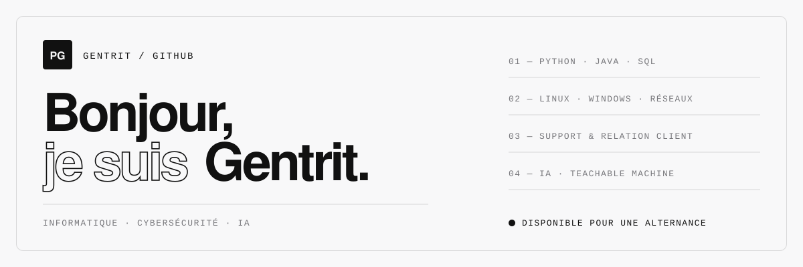

<picture>
  <source media="(prefers-color-scheme: dark)" srcset="assets/banner-dark.svg">
  
</picture>

<p align="left">
  <a href="https://gentritfactory.ch/portfolio/"></a>
  <a href="https://www.linkedin.com/in/gentrit-pajaziti-193518259/"></a>
  <a href="mailto:gentmusica@gmail.com"></a>
  
</p>

**Étudiant en informatique**, à l’aise dans le contact humain. J’aime écouter les besoins des utilisateurs, communiquer clairement et trouver des solutions concrètes — entre la technique (systèmes, réseaux, cybersécurité, IA) et les personnes qui l’utilisent.

<br>

### `01 / À propos`

```python
class Gentrit:
    role       = "Étudiant en informatique · École Schulz Genève"
    location   = "Romanel-sur-Lausanne, Suisse"
    focus      = ["Cybersécurité", "Intelligence artificielle", "Réseaux & systèmes"]
    experience = "Administrateur système débutant · AlyxIA Solutions"
    learning   = ["Labs LabEx", "Linux", "Nmap", "Python scripting"]
    looking_for = "Alternance ou stage — cyber, infrastructure, intégration IA"
```

<br>

### `02 / Compétences`

**Informatique**


**Support & relation client**


<br>

### `03 / Expériences & projets`

<table>
  <tr>
    <td width="50%" valign="top">
      <sub><code>PROJET D’ÉQUIPE · STARTUP ÉTUDIANTE</code></sub>
      <h4>AlyxIA Solutions — IA métier pour les PME</h4>
      <p>Avec d’autres étudiants de l’École Schulz Genève : une IA déployée en local, connectée aux documents internes, sans dépendance au cloud. J’y ai fait mes premiers pas comme <b>administrateur système</b> (niveau débutant).</p>
      <a href="https://gentritfactory.ch/alyxia-solutions/">Voir le site du projet ↗</a>
    </td>
    <td width="50%" valign="top">
      <sub><code>LABEX · PRATIQUE CONTINUE</code></sub>
      <h4>Apprentissage pratique en cybersécurité</h4>
      <p>En parallèle de ma formation, je m’entraîne sur des labs pratiques : administration Linux, reconnaissance réseau avec Nmap, bases de l’audit et du pentest, et scripting Python.</p>
      <a href="https://labex.io/">Découvrir LabEx ↗</a>
    </td>
  </tr>
</table>

<br>

### `04 / En ce moment`

- 🔐 J’approfondis la **sécurité réseau** et le durcissement des systèmes
- 🤖 J’explore l’**IA appliquée** : modèles génératifs, agents, Teachable Machine
- 🐧 Je consolide mes bases **Linux** et **administration système**
- 💬 J’ouvre ce GitHub à mes projets d’école et labs — n’hésitez pas à jeter un œil

<br>

<sub>En dehors de l’écran : fitness · vélo · randonnée · cinématographie</sub>
